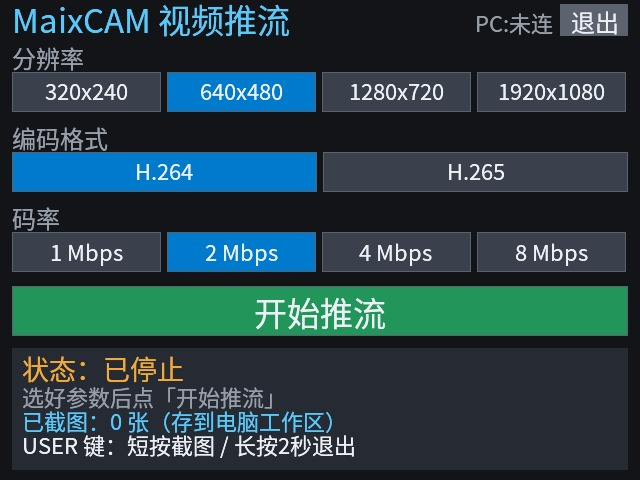
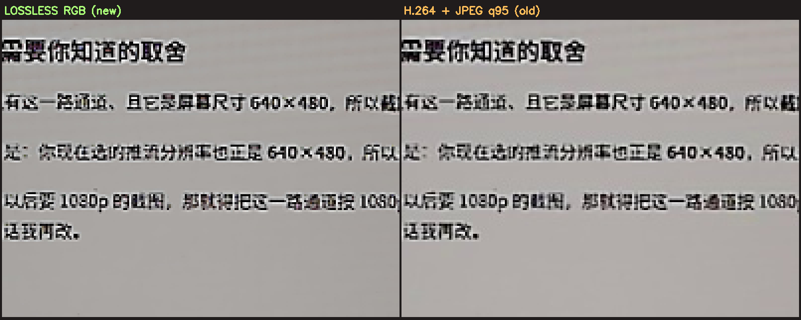

# maxicam —— MaixCAM Pro 采集端

「去摩尔纹」项目的**图像采集端**：MaixCAM Pro 触屏选参数 → RTSP 推流给电脑/Zynq；
按板子 USER 键可截取**未经视频压缩的原始 RGB**、存成无损 PNG（摩尔纹这种高频信息靠它才能留住）。

```
MaixCAM Pro ──┬─ 摄像头 NV21 ──> H.264/H.265 硬编 ──> RTSP :8554 ──> 电脑窗口（有损，看画面）
              ├─ 显示通道 RGB888 ──> 640x480 预览
              │        └── 按键取一帧 ──> 原始像素 TCP :8556 ──> 无损 PNG（截图）
              └─ 控制通道 TCP :8555（JSON：状态 / 命令 / 截图通知）
```



---

## 目录

```
maxicam/
├── HANDOVER.md          ★ 交接文档（先看这个：状态、代码地图、10 条坑）
├── ENVIRONMENT.md       ★ 开发环境配置清单（照着重现）
├── apps/
│   ├── maixcam/           设备端应用（触屏 UI + 推流 + 截图）
│   ├── pc/                电脑端（RTSP 接收 + 窗口 + 无损截图）
│   ├── deploy.py          部署/安装/停止设备端应用
│   └── README.md          完整使用说明
├── scripts/               验证与调试脚本
└── docs/
    ├── maixcam-to-zynq-video.md   带宽实测与接 Zynq 的方案对比
    ├── reference/                 官方 USB 模式脚本、AX7015B 手册
    └── assets/                    界面/窗口/截图对比
```

---

## 快速开始

```bash
# 1) 设备端：装进设备菜单（只做文件操作，不碰桌面）
cd apps && ./deploy.py install
#    然后重启一次设备（launcher 只在启动时读 app.info）
#    再在板子菜单点「视频推流」→ 选分辨率/编码/码率 → 开始推流

# 2) 电脑端：开窗口看画面
./pc/run.sh --host 10.13.148.1
```

窗口快捷键：**空格**=请设备抓一张原始图、**q** 退出、**f** 全屏。
截图落在 `<工作区>/shots/maixcam_<时间>_no<序号>_<WxH>_RGB888.png`（无损）。

> 界面点不动、退不出去时，在电脑上执行 `./pc/send_cmd.py quit` —— 让设备端应用**优雅退出**
> （**不要** `kill -9`，会把摄像头的 MMF 资源弄脏，详见 HANDOVER.md §5.1）。

---

## 效果

无损 RGB 截图 vs 从 H.264 视频里截的图（放大 4 倍）。右侧是旧的二次压缩结果，
文字边缘的块效应/振铃就是摩尔纹丢失的原因：



---

## 现状

- ✅ 触屏选参数、RTSP 推流（30fps）、H.264/H.265、320×240 ~ 1920×1080
- ✅ 无损 RGB 截图（640×480，0.18s 送达）
- ✅ 优雅启停、远程 `quit` 急救
- ⚠️ 截图分辨率固定 640×480（受摄像头 VI 通道数限制，见 HANDOVER.md §5.4）
- ⚠️ 1080p 只有 30fps
- ⚠️ 只能在设备菜单点开应用，不能从 SSH 起进程抢屏幕
