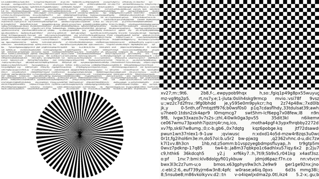

# 2K 无损采集改造方案（MaixCAM Pro → PC）

> 状态：**采集 + 自动对齐 + 离线配对 已实现**（camera 分支）
> - 设备端 `capture_still()`：`apps/maixcam/main.py`，`capture` 命令，支持 `crop`（中心裁剪，像素级子集）
> - 设备端 UI：推流界面底部 `[停止][截图][采集][退出]`，预览上画**采集区方框**；USER 键短按 = 2K 中心采集
> - PC 端全自动采集：`apps/pc/capture_pairs.py`（`--crop N`；Windows 用 `capture_pairs.bat`）
> - PC 端**自动对齐**：`capture_pairs.py --calib`（ArUco 四角标记 → 单应 H）
> - PC 端**离线配对**：`apps/pc/extract_pairs.py`（用 H 把源图映射到相机坐标，取同一块 256 当 GT）
> - 能力探针：`scripts/probe_modes_2k.py`、`scripts/probe_crop256.py`
> 目标：用 2560×1440 原生像素采集训练数据，每张图无损落到电脑，并和「屏幕源图」配对。

## 0. 三步流程（先标定 → 再采集 → 最后配对）

```bash
# 1) 标定（同一套光学 setup 只需一次；相机/屏幕一动就要重做）
python capture_pairs.py --out D:\shots\run01 --calib
#    全屏显示 ArUco 标定页 → 拍一张全幅 → 求 H → 写 run01/session.json
#    另存 calib_page.png / calib_cam.png / calib_vis.png 供检查
#    看日志里的 RMS（正常 < 2 px）和「屏幕在画面中占比」（应在 25%~160%）

# 2) 采集（只要相机画幅正中心 256×256）
python capture_pairs.py --src D:\shots\src --out D:\shots\run01 --crop 256

# 3) 生成 GT（不需要设备）
python extract_pairs.py --run D:\shots\run01
#    每对得到 pairs/pXXXXXX_{cam.png, src.png, gt.png, json}
```

**为什么必须 `--crop` 而不是 resize**：设备端做的是 **crop（像素级子集）**。
resize 会重采样、改掉摩尔纹的频率成分（数据集直接作废）。
同时 USB 每帧从 10.5 MB 降到 192 KB（省 56 倍），还顺带避开了镜头四角的暗角。

**H 的方向约定**（`extract_pairs.py` 依赖，改代码时务必同步）：
`H` = **画布(屏幕)像素 → 相机像素**；源图 → 画布的偏移是 `paste_x/crop_x0`；
`cv2.warpPerspective` 内部会**再取一次逆**，所以传进去的必须是 **源图 → 相机**（`H · T⁻¹`）。
这两处方向任意一处写反，GT 会整块错位（实测错位量 = 几十像素，肉眼看不出但训练全废）。

**离线自检（不需要设备）**：
- 用已知 H 把 ArUco 标定页 warp 后反求 H → 四角偏差应 < 1 px（实测 0.84 px）
- 用同一 H 正向 warp 源图得到"假 cam"，再走 `extract_pairs` → 往返误差应 = 0（实测 0.00）


---

## 0. 怎么跑（Windows）

```bat
REM 0) 装依赖（若已有 apps/pc 那套环境可跳过）
pip install -r apps\pc\requirements-capture.txt

REM 1) 先探设备能力（2K 能不能开、要不要退 NV21）
scp scripts\probe_modes_2k.py root@10.13.149.1:/root/
ssh root@10.13.149.1 "python3 /root/probe_modes_2k.py"

REM 2) 自检：不连相机，验证显示/命名/断点续采
apps\pc\capture_pairs.bat --src D:\shots\src --out D:\shots\run01 --dry-run

REM 3) 正式采集
apps\pc\capture_pairs.bat --src D:\shots\src --out D:\shots\run01 --res 2560x1440 --distance 62
```

Windows 上设备是 **RNDIS → 10.13.149.1**；不传 `--host` 时脚本两个地址都会试。

产物：

```
run01/
├── session.json
├── pairs/p000001_{cam.png,src.png,json}
└── index.jsonl
```

### 0.1 屏幕源图从哪来（`make_src_pages.py`）

**图片只放在电脑上，不需要传给相机**（PC → 相机只有 JSON 命令，没有任何图片文件；
相机拍的是屏幕的物理画面）。

素材来源，按优先级：

| 来源 | 说明 | 注意 |
|---|---|---|
| **UHDM 的 `*_gt.jpg`（干净图）** | 4500 张 4032×3024，在 CP2 移动盘 `uhdm_data/Train/pair_*/` | **绝不能用 `*_moire.jpg`**——那本身就带摩尔纹，再拍一遍 GT 就说不清 |
| **合成页**（文字/栅格/棋盘/星） | 脚本直接生成，不依赖外部数据 | 文字和细栅格上的摩尔纹最典型；棋盘还能当标定板 |
| 其它 4K 图库（DIV2K 等） | 需要下载 | 同样只能用干净图 |

```bat
REM 从 UHDM 干净图里抽 300 张，裁成 2560x1440（原生像素裁切，不重采样）
python apps\pc\make_src_pages.py --in E:\uhdm\Train --out D:\shots\src ^
    --w 2560 --h 1440 --limit 300 --pos random

REM 再加 60 张合成页（文字/栅格/棋盘/星）
python apps\pc\make_src_pages.py --out D:\shots\src --synthetic 60 --w 2560 --h 1440

REM 单独生成一张标定棋盘（80 px 格）
python apps\pc\make_src_pages.py --out D:\shots\calib --calib --w 2560 --h 1440
```

- 输出 `0001.png …` + `manifest.csv`（记录每张的来源与裁切偏移），支持增量追加
- 图比屏幕大 → **原生像素裁切**（随机位置，多样性更好），不做重采样
- 图比屏幕小 → 居中贴黑底，**不放大**（放大等于替相机造细节）
- 建议比例：干净照片 2/3 + 合成页 1/3；源图 200~400 张 × 6~8 个距离档 ≈ 1200~3200 对

示意（文字页 / 棋盘 / 西门子星）：




---

## 1. 物理连接

一根 USB-C 线接到电脑（数据 + 供电）。设备枚举成 **USB 网卡（NCM/RNDIS）**，
电脑出现 `enx…` 接口，设备固定 `10.13.148.1`，SSH `root/root`。

**不是 U 盘模式**：不挂载存储、不拷文件，走的是网络协议。

| 端口 | 方向 | 用途 | 质量 |
|---|---|---|---|
| 8554 | 设备 → PC | RTSP 视频流（取景用） | 有损 H.264 |
| 8555 | 双向 | JSON 控制/状态 | 文本 |
| 8556 | 设备 → PC | 原始 RGB888 像素 | **无损** |

帧头：`SHOT_MAGIC(4s) + seq(4) + w(4) + h(4) + len(4)`，大端；随后是 `len` 字节像素。

## 2. 数据流

```
PC 全屏显示 src 图（1:1，不缩放）
   └─ 8555: {"t":"cmd","cmd":"shot"}
        └─ 设备取一帧 → 8556 推 11,059,200 B
             └─ PC 校验 len → 存 PNG → 写 meta.json
```

设备端**不落盘**（现有 `apps/maixcam/main.py` 里没有任何图像写存储的代码），
所以「相机存储不够」不是问题；风险是链路中断导致单张丢失，需要 PC 侧校验 + 重拍。

## 3. 为什么要独占通道

MaixCDK `MMF_VI_MAX_CHN = 2`：主 NV21（绑 RTSP）+ 显示通道 640×480 已占满，
截图现在复用显示通道，所以**最大只有 640×480**，且 640×480 是 ISP 从 2K 缩出来的
（摩尔纹已被改变）。

方案 A（推荐）：**拍摄瞬间独占相机**

```
stop_stream()            # server.stop() + cam.close()
sleep ≥1.5s              # VI/VPSS 释放，硬约束
camera.Camera(2560,1440, FMT_RGB888)   # 只用 1 路通道
read ×8 丢帧             # AEC/AWB 收敛
img = read()             # 11 MB
shot_srv.push_image(seq, img)          # ≈0.52s @170Mbps
cam.close()
start_stream()           # 可选：恢复预览
```

单张约 4~4.5 s（含 1.5 s 死等）。备选方案 B（常驻 2K 显示通道）预览只能到 2~5 fps，
内存吃紧，仅在需要实时取景时考虑。

**兜底**：2K `FMT_RGB888` 打不开 → 开 `FMT_YVU420P` + `to_format(RGB888)`（+0.2 s）。

## 4. 时序与同步

**没有帧级同步，也不需要**：屏幕上是静止图，配对靠「会话」而非「帧对齐」。
唯一约束：从触发到拍完（约 4 s）屏幕不能换图。

```
t=0.0  PC 显示 src（等 300ms 稳定）
t=0.3  PC 发 shot
t=0.4  设备 stop_stream
t=1.9  设备等满 1.5s
t=2.6  设备开 2K 通道
t=2.9  连续读 8 帧丢弃
t=3.0  取 1 帧
t=3.6  传输完成
t=3.8  PC 收满、校验、存 PNG（0.2~0.4s）
t=4.2  PC 写 meta，切下一张
t=4.5  设备恢复推流
```

## 5. 命名与配对

设备 `seq` 应用重启会归零，**不能当主键**。主键由 PC 自增生成。

```
datasets/capture/20261025_run01/          # 一个 session = 一套固定光学 setup
├── session.json                          # 相机参数/距离/镜头/曝光/标定 H
├── src/0001.png                          # 屏上源图（每张只一份）
├── pairs/
│   ├── p000001_cam.png                   # 相机 2K 原始帧（无损）
│   ├── p000001_src.png                   # 硬链接到 src/0001.png
│   └── p000001.json
└── index.jsonl                           # 一行一对
```

`p000001.json`：

```json
{
  "pair_id": "p000001",
  "session": "20261025_run01",
  "seq_dev": 17,
  "ts_pc": "2026-10-25T16:12:03.412+08:00",
  "src_id": "0001",
  "cam": {"w": 2560, "h": 1440, "fmt": "RGB888", "bytes": 11059200},
  "setup": {"distance_cm": 62, "angle_deg": 7, "exposure_us": 8000, "gain": 0},
  "H": [[1.0021, -0.0033, -12.4], [0.0021, 1.0018, -8.9], [0, 0, 1]],
  "cam_sha256": "…"
}
```

- 对齐**不在采集时做**：只保证「整帧 + 源图 + H + 元数据」齐全，256 裁剪离线做，可重跑。
- 训练集另生成：`datasets/moire256/train/{source,target}/p000001.png`，stem 不变。

## 6. 改动清单

| 文件 | 改动 | 工作量 |
|---|---|---|
| `apps/maixcam/main.py` | `CAPTURE_MODES`、`capture_still()`、`do_shot()` 分流、`_emit_shot` 加字段、面板加「采集」行 | 1~1.5 天 |
| `apps/pc/receiver.py` | 协议不用改；加 sidecar 读写 | 0.5 天 |
| `apps/pc/capture_pairs.py` | **新建**：全自动遍历图库 → 显示 → 触发 → 收图 → 写 meta → 重试 | 1 天 |
| `scripts/probe_modes_2k.py` | 已写好，先在设备上跑 | 0 |

## 7. 先决条件（拍之前必须确认）

1. `probe_modes_2k.py` 能开出 `2560×1440`；是 RGB888 还是要退 NV21
2. 曝光/增益/白平衡能锁定（不能锁就取 30 帧里行方差最小的一帧）
3. 只用 2560×1440 原生档；1080p 是 ISP 缩的，1280×720 是另一档，**同批数据不能混**
4. 部署时相机取图方式：2K 原生 ROI 裁 256（则数据有效）还是 ISP 缩到 256（则数据作废）
